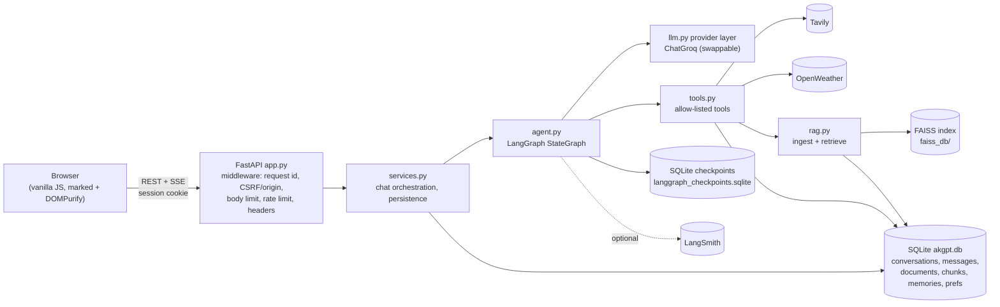

# AKGPT

AKGPT is a ChatGPT-style **agentic AI assistant**: streaming chat, multiple conversations, document Q&A
(RAG), live web search, current weather, a safe calculator and explicit long-term memory.

It is built on **Groq + LangGraph + FAISS + FastAPI + SQLite** and is a derivative of the open-source
[BappyGPT](https://github.com/entbappy/BappyGPT) project (Apache-2.0). See [License and attribution](#license-and-attribution).

> **Security model.** AKGPT has **no user accounts**. It is a **single-user / local prototype**: each browser
> receives an anonymous, HttpOnly session cookie, and conversations, documents and memories are isolated per
> session. That prevents one browser from reading another's data, but it is *not* production multi-user
> security. Put it behind real authentication before exposing it to the internet.

## Features

- Real-time **SSE streaming**, stop generation, regenerate, edit-and-resubmit, retry on error
- Multiple persistent conversations, rename, delete, clear, export to Markdown/TXT
- Groq model selector (models configurable via env), temperature and retrieval top-k preferences
- **Document Q&A**: PDF, DOCX, TXT, MD, CSV, PY → FAISS, with `[filename, page N]` citations
- Tools: `web_search` (Tavily), `get_weather` (OpenWeather, current conditions), `calculator` (AST-based, no `eval`),
  `search_uploaded_documents`, `remember_information`, `recall_memory`, `update_memory`, `forget_memory`,
  `search_conversation_history`
- Drag-and-drop upload with indexing status, source citations, tool-status chips, light/dark theme
- Optional browser speech-to-text dictation in the chat composer (browser support and microphone permission required)
- Optional **LangSmith** tracing; app works fully with tracing off
- Docker image, Compose file with persistent volumes, health check, GitHub Actions CI

Not implemented (so not claimed): image understanding, spoken audio output, live browsing, user accounts.

## Architecture



Graph: `START → prepare → chatbot → (tool calls? → tools → chatbot | END)`. The tool loop is bounded by
`MAX_AGENT_STEPS`; when the limit is hit the model is asked to answer with what it has.

### How the pieces fit

- **Tool choice.** The system prompt describes when to use each tool; Groq tool calling picks them, and arguments are
  validated by Pydantic schemas. Each tool runs under a timeout, and the whole loop is capped by `MAX_AGENT_STEPS`. Tool output is passed back to the model
  wrapped as *untrusted data*, and the system prompt forbids following instructions found in it.
- **FAISS.** `IndexIDMap2(IndexFlatIP)` over L2-normalised embeddings (inner product = cosine). Chunk text and metadata
  live in SQLite (the docstore), so nothing is unpickled from disk. Retrieval over-fetches, then filters by session and
  conversation, applies a minimum score, and optionally reranks with a cross-encoder (`RERANKER_MODEL`). Writes are
  serialised with a lock and the index is saved atomically. The index records its embedding model and dimension; on a
  mismatch it refuses to load and tells you to rebuild.
- **SQLite + checkpoints.** `akgpt.db` is the source of truth for the UI (messages, titles, documents, memories).
  LangGraph checkpoints (`langgraph_checkpoints.sqlite`) hold the agent's working state per `thread_id`. Deleting or
  clearing a conversation removes both. Only a bounded window (`MAX_HISTORY_MESSAGES`) is sent to the model.
- **Streaming.** `POST /api/chat/stream` returns `text/event-stream` with named events: `meta`, `delta`, `reset`,
  `tool_start`, `tool_end`, `done` and `error`, plus heartbeats. A `done` event always ends the stream. The user message is
  saved before generation and the assistant message once on completion (partial text is stored with an "interrupted"
  flag if the client disconnects or stops).

## Technology stack

Python 3.11, FastAPI, Uvicorn, Pydantic / pydantic-settings, SQLAlchemy + SQLite, LangGraph (+ SQLite checkpointer),
langchain-groq, FAISS (CPU), sentence-transformers, pypdf, python-docx, Tavily and OpenWeather over httpx, LangSmith,
Jinja2, vanilla HTML/CSS/JS, pytest.

## Project structure

```
app.py            FastAPI app, middleware, routes
services.py       chat orchestration, SSE framing, deletion/retention
agent.py          LangGraph agent, bounded tool loop, streaming events
llm.py            chat-model provider factory (Groq default)
tools.py          tool registry and implementations
rag.py            ingestion, FAISS index, retrieval
database.py       SQLite access layer (transactions, scope-checked queries)
models.py         SQLAlchemy models        schemas.py   Pydantic API schemas
config.py         pydantic-settings        security.py  scope ids, filename/PII helpers, rate limiter
exceptions.py     safe error types         logging_config.py  structured, redacting logs
templates/ static/   frontend (static/vendor = marked, DOMPurify)
scripts/          init_db.py, rebuild_faiss.py
tests/            pytest suite (all external services mocked)
Dockerfile  docker-compose.yml  .dockerignore  .env.example  .github/workflows/ci.yml
```

Structural additions beyond the requested list: `llm.py` (provider abstraction), `services.py` (keeps logic out of route
handlers), `security.py`, `NOTICE`, and `static/vendor/`.

## Prerequisites

Python 3.11, ~2 GB disk for dependencies (PyTorch via sentence-transformers). The first run downloads the embedding model
(~90 MB) from Hugging Face, so it needs internet access once. Docker is optional.

## Local setup

```bash
python3.11 -m venv .venv
source .venv/bin/activate            # Windows: .venv\Scripts\activate
pip install -r requirements.txt
cp .env.example .env                 # then edit .env
python scripts/init_db.py            # optional: the app also creates the schema at startup
uvicorn app:app --host 0.0.0.0 --port 8080
```

Open <http://localhost:8080>. For auto-reload during development add `--reload`.

### Configuration

All settings come from environment variables or `.env` (see `.env.example`; placeholders only). Keys are never sent to the
browser or logged. Important ones:

| Variable | Purpose |
|---|---|
| `GROQ_API_KEY`, `GROQ_MODEL`, `GROQ_MODELS` | chat model, default and selectable list (availability changes; check the Groq console) |
| `TAVILY_API_KEY`, `OPENWEATHER_API_KEY`, `WEATHER_UNITS` | optional tools; without keys the tool reports it is not configured |
| `LANGSMITH_TRACING`, `LANGSMITH_API_KEY`, `LANGSMITH_PROJECT`, `LANGSMITH_ENDPOINT` | optional tracing |
| `DATABASE_URL`, `CHECKPOINT_DB_PATH`, `FAISS_INDEX_PATH`, `UPLOAD_DIR` | storage locations |
| `EMBEDDING_MODEL`, `CHUNK_SIZE`, `CHUNK_OVERLAP`, `TOP_K`, `MAX_UPLOAD_SIZE_MB` | RAG |
| `MAX_HISTORY_MESSAGES`, `MAX_AGENT_STEPS`, `ALLOWED_ORIGINS`, `APP_ENV`, `COOKIE_SECURE` | agent and server |

`EMBEDDING_PROVIDER=hash` selects a deterministic offline embedder used by the tests; it has no semantic quality, so do not
use it for real documents.

When Groq returns a rate-limit response, AKGPT tries the other models in `GROQ_MODELS` for that request and reports the
model that succeeded. This can help with per-model limits; account-wide quota limits still require waiting or increasing
the Groq account quota. Keep the configured list limited to models enabled for your Groq account.

### API keys

- **Groq** (required for chat): create a key at <https://console.groq.com/keys> and set `GROQ_API_KEY`.
- **Tavily** (web search): <https://app.tavily.com> → `TAVILY_API_KEY`.
- **OpenWeather** (weather): <https://home.openweathermap.org/api_keys> → `OPENWEATHER_API_KEY`. New keys can take a
  while to activate. Only *current* conditions are implemented; no forecast is ever fabricated.
- **LangSmith** (optional): <https://smith.langchain.com> → set `LANGSMITH_TRACING=true` and `LANGSMITH_API_KEY`. Open the
  `AKGPT` project to inspect runs, tool calls and failures. Inputs are hidden from traces by default
  (`LANGSMITH_HIDE_INPUTS`). If LangSmith is unreachable, chat keeps working.

## Using AKGPT

- **Documents:** click the paperclip or drop a file onto the page. Once it shows *indexed*, ask about it ("What does the
  report say about Q3 risks?"). Answers cite `[filename, page N]`. Documents belong to the conversation they were uploaded
  in. Delete a document from the sidebar to remove its file, chunks and vectors.
- **Web search / weather:** just ask ("latest news about …", "weather in Pune, IN"). Tool chips show what ran; web answers
  list the source URLs.
- **Memory:** "Remember that I prefer concise answers." Later: "What do you remember about me?" Memory can be corrected
  or deleted by asking, or through `/api/memories`. Obvious secrets (keys, card numbers) are refused.

## API

`GET /health`, `GET /api/models`, `POST /api/chat`, `POST /api/chat/stream`,
`GET|POST /api/conversations`, `GET|PATCH|DELETE /api/conversations/{thread_id}`,
`DELETE /api/conversations/{thread_id}/messages`, `GET /api/conversations/{thread_id}/export`,
`POST /api/upload`, `GET /api/documents`, `DELETE /api/documents/{document_id}`,
`GET /api/memories`, `PATCH|DELETE /api/memories/{memory_id}`, `GET|POST /api/settings`.
Interactive docs at `/docs` are enabled only when `APP_ENV` is not `production`.

## Tests

```bash
pytest
```

All external services (Groq, Tavily, OpenWeather, LangSmith) are mocked and the offline hash embedder is used, so no
credentials or downloads are needed. Coverage includes startup/health, validation, conversation CRUD, SSE events,
LangGraph routing and tool calls, RAG ingestion/persistence/reload/deletion, session isolation, calculator safety,
upload and path-traversal rejection, missing-key behaviour and LangSmith-off mode.

## Docker

```bash
docker build -t akgpt .
docker run --rm -p 8080:8080 --env-file .env \
  -v akgpt_data:/app/data -v akgpt_uploads:/app/uploads -v akgpt_faiss:/app/faiss_db akgpt
```

Compose (works without a `.env`; chat then reports that `GROQ_API_KEY` is missing):

```bash
docker compose up --build -d
docker compose logs -f akgpt
docker compose down            # volumes are kept; add -v to delete data
```

The image runs as a non-root user, never contains `.env`, and has a `/health` check. The Hugging Face model cache is stored
in the data volume so it is downloaded once. Set `COOKIE_SECURE=true` when serving over HTTPS.

### Persistent data and backups

State lives in three volumes: `akgpt_data` (SQLite + checkpoints + model cache), `akgpt_uploads`, `akgpt_faiss`.

```bash
# back up
docker run --rm -v akgpt_data:/d -v "$PWD":/b alpine tar czf /b/akgpt_data.tgz -C /d .
docker run --rm -v akgpt_uploads:/d -v "$PWD":/b alpine tar czf /b/akgpt_uploads.tgz -C /d .
docker run --rm -v akgpt_faiss:/d -v "$PWD":/b alpine tar czf /b/akgpt_faiss.tgz -C /d .
# restore: same command with `tar xzf` into an empty volume, while the container is stopped
```

For a local install, stop the app and copy `data/`, `uploads/` and `faiss_db/`. Back up while the app is stopped so the
SQLite WAL is consistent. The FAISS index can always be regenerated from SQLite (below).

### Changing the embedding model

Vectors from different models are not comparable, so a changed `EMBEDDING_MODEL` makes the app refuse the old index. Run
`python scripts/rebuild_faiss.py` to re-embed all stored chunks.

## Security considerations

Implemented: session-scoped data access on every read/update/delete endpoint; origin check on state-changing requests;
request-size and upload-size limits; extension + file-signature + content validation; generated storage names and sanitised
display names (no path traversal); FAISS/docstore never unpickled; per-session rate limiting; CSP and other security
headers; Markdown rendered with marked and sanitised with DOMPurify; secrets held as `SecretStr` and redacted from logs;
generic error messages (no stack traces); allow-listed tools only, no code or shell execution; bounded agent steps and
tool timeouts; FAISS index checksum verified before load; retrieved and web content treated as untrusted; non-root container; `/docs` off in production.

## Limitations

- No authentication or multi-tenant authorization; the session cookie is the only isolation boundary.
- Prompt-injection defences are mitigations, not guarantees.
- The rate limiter is in-process, so it is per-worker and resets on restart. Run a single Uvicorn worker (FAISS is
  protected by an in-process lock).
- Flat FAISS index: exact search, intended for thousands, not millions, of chunks.
- Weather is current conditions only. Scanned/image-only PDFs have no extractable text (no OCR).
- Model names and capabilities on Groq change; adjust `GROQ_MODELS` if one is retired.
- The Docker image has not been built in the environment where this was authored (no Docker daemon was available); CI builds it.

## License and attribution

Licensed under the Apache License 2.0 (see `LICENSE`). AKGPT is a derivative work inspired by BappyGPT by entbappy,
also Apache-2.0; see `NOTICE` for the list of changes and bundled third-party libraries.
